# Sơ đồ các workflow đã hoàn thành (P0 – P3)

Quy ước màu trong mọi sơ đồ:

- 🟩 **Xanh lá** = đầu vào (input)
- 🟦 **Xanh dương** = đầu ra (output)
- 🟥 **Đỏ** = bị từ chối / dừng
- Hình thoi = điểm rẽ nhánh (kiểm tra điều kiện)

Danh sách:

1. Tổng quan hệ thống
2. Đăng nhập và xác định vai trò
3. Chatbot hỏi đáp (vòng lặp agent)
4. Tra cứu tài liệu KB (RAG)
5. Cập nhật KB từ Google Drive
6. Cập nhật KB từ website lab (crawl)
7. Nộp đơn: thu thập thông tin → bản xem trước
8. Xác nhận và lưu đơn (3 loại đơn)
9. Thao tác cần xác nhận: trả / gia hạn thiết bị, quản lý thành viên
10. Các job chạy định kỳ
11. Publish mẫu đơn lên Drive

---

## 1. Tổng quan hệ thống

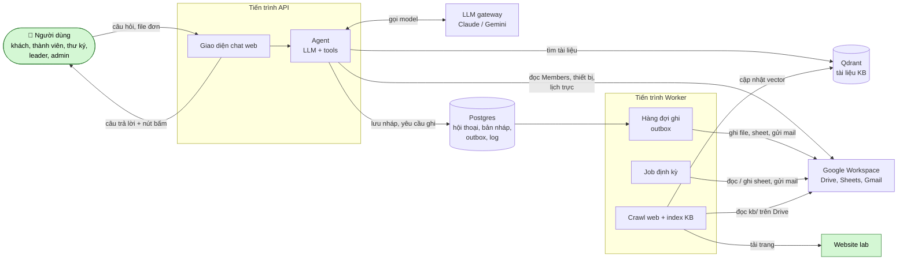

---

## 2. Đăng nhập và xác định vai trò

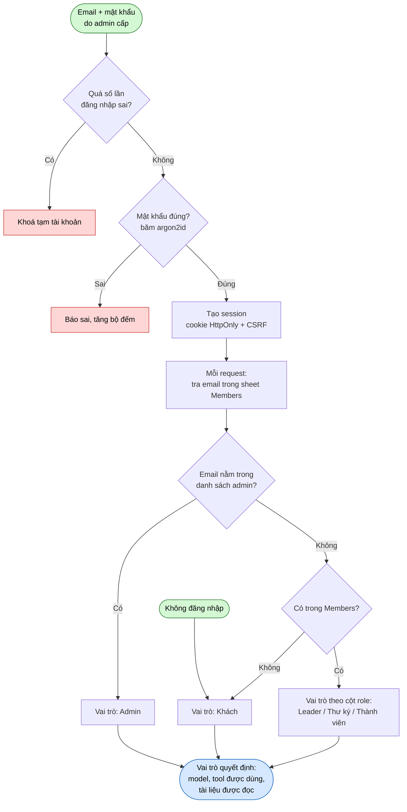

---

## 3. Chatbot hỏi đáp (vòng lặp agent)

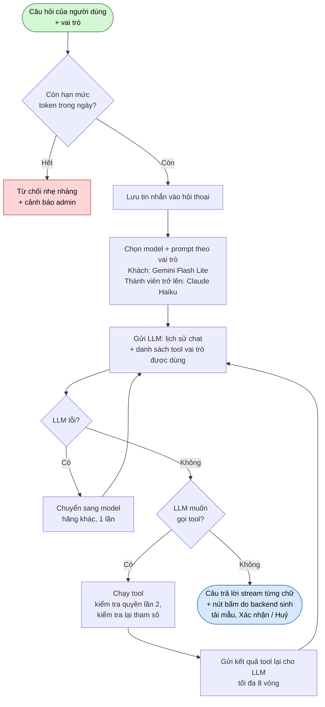

**Tool theo vai trò** (LLM chỉ thấy tool của vai trò mình):

| Nhóm | Tool | Ai dùng được |
|---|---|---|
| Hỏi đáp | `search_kb`, `list_forms` | Tất cả |
| Hỏi đáp | `get_application_status` | Khách |
| Tra cứu lab | `query_equipment`, `query_duty`, `query_members`, `my_borrows` | Thành viên trở lên |
| Duyệt đơn | `list_pending_applications` | Leader, Admin |
| Đơn từ | `get_form_template`, `start_form`, `update_form_fields`, `attach_file`, `submit_filled_form`, `render_preview`, `cancel_form` | Theo quyền từng đơn |
| Thao tác ghi | `return_equipment`, `extend_borrow` | Thành viên, thư ký, leader |
| Thao tác ghi | `request_member_change` | Leader, Admin (đổi vai trò: chỉ Admin) |

---

## 4. Tra cứu tài liệu KB (tool `search_kb`)

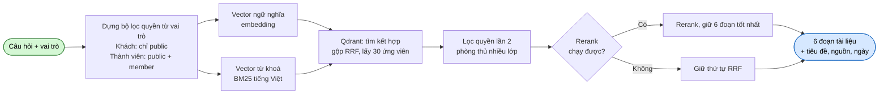

---

## 5. Cập nhật KB từ Google Drive (job `kb_sync`, `kb_reconcile`)

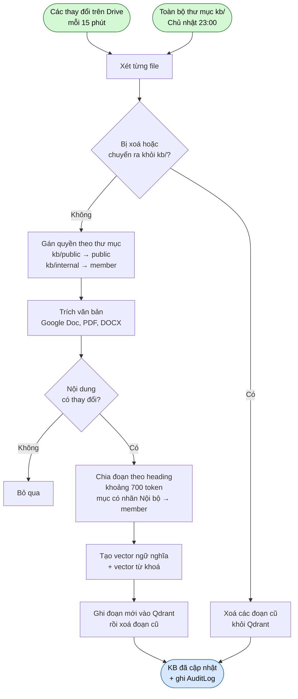

---

## 6. Cập nhật KB từ website lab (job `web_crawl`)

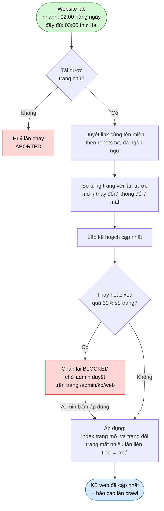

---

## 7. Nộp đơn: thu thập thông tin → bản xem trước

Áp dụng cho 3 đơn: **đơn xin gia nhập**, **phiếu mượn thiết bị**, **biên bản họp**.

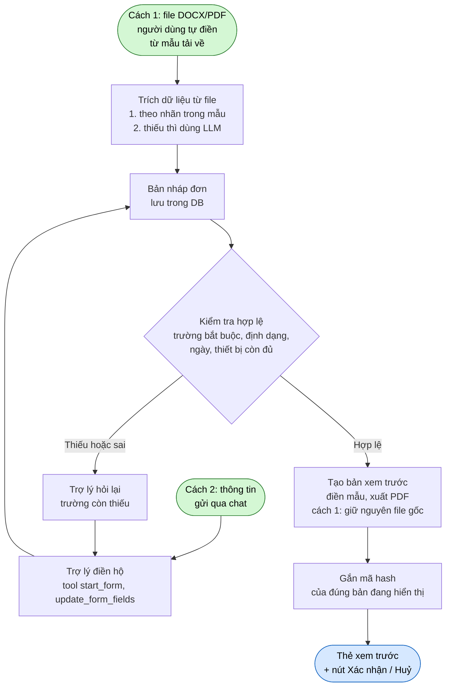

Thông tin người nộp (họ tên, email…) của thành viên lấy theo tài khoản, không sửa được qua chat.

---

## 8. Xác nhận và lưu đơn

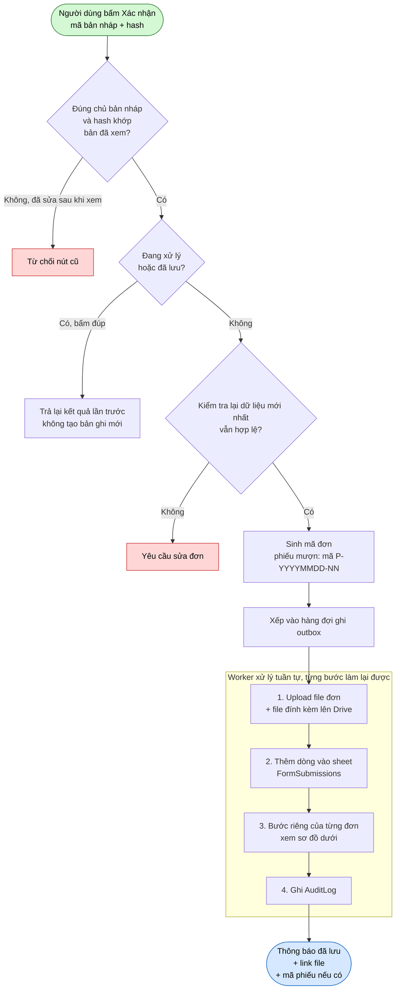

**Bước riêng của từng loại đơn:**

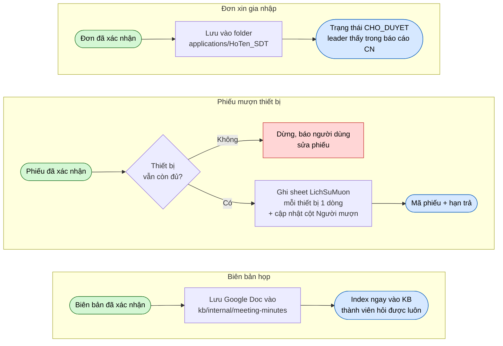

Hai người cùng mượn món thiết bị cuối cùng: worker chạy lần lượt nên người sau bị dừng ở bước kiểm tra, chỉ đúng một người thành công.

**Cách worker đảm bảo không mất / không trùng dữ liệu:**

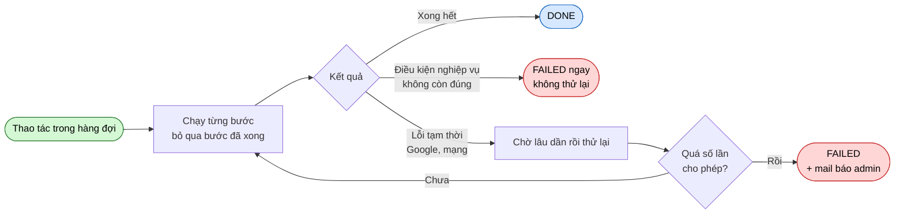

---

## 9. Thao tác cần xác nhận: trả / gia hạn thiết bị, quản lý thành viên

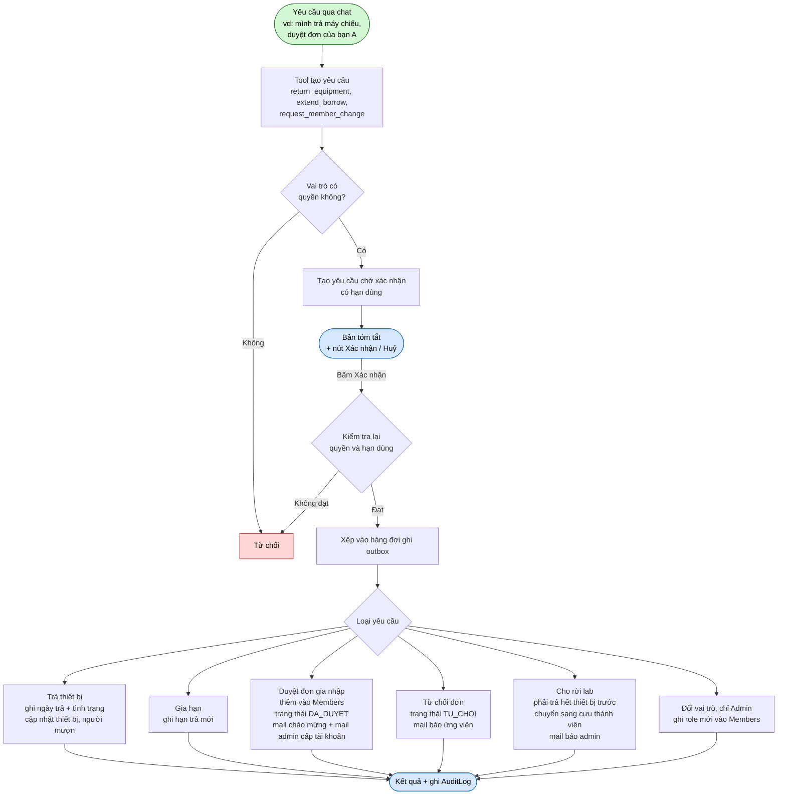

| Thao tác | Ai được làm |
|---|---|
| Trả / gia hạn thiết bị | Thành viên, thư ký, leader |
| Duyệt / từ chối đơn, cho rời lab | Leader, Admin |
| Đổi vai trò (leader, thư ký) | Chỉ Admin |

---

## 10. Các job chạy định kỳ

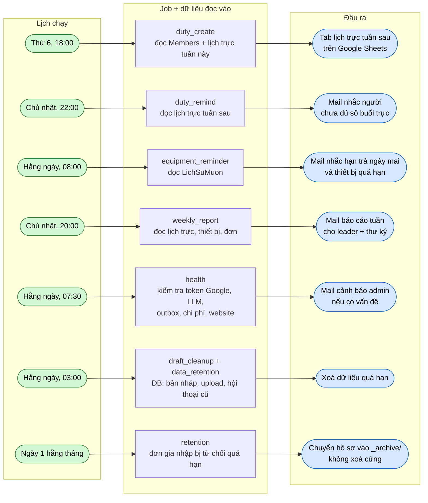

Mọi job đều chạy lại an toàn: mỗi lần gửi mail / tạo tab có khoá chống trùng, chạy lần 2 không gửi lặp. Có thể chạy tay bằng `labagent job run <tên> --dry-run`. Hai job KB (`kb_sync`, `kb_reconcile`) và crawl web nằm ở sơ đồ 5 và 6.

---

## 11. Publish mẫu đơn lên Drive (`labagent forms publish`)

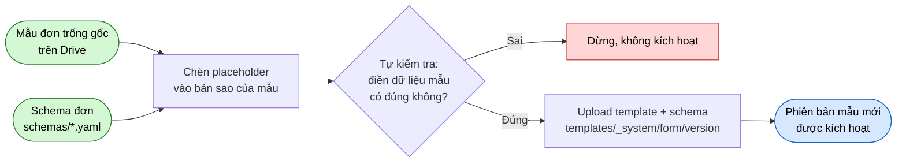
